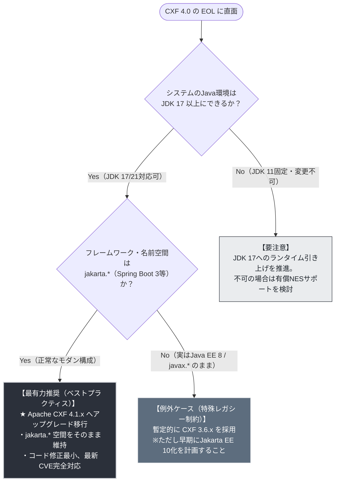
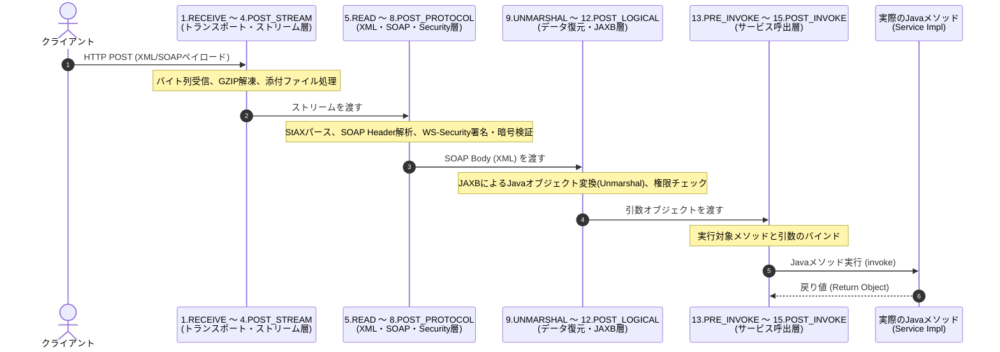

# Apache CXF 4.0 EOLに伴うバージョン選定および移行方針評価書

> **対象読者**: システムアーキテクト、プロジェクトマネージャー、テックリード、および開発チーム  
> **評価基準日**: 2026年10月  
> **作成種別**: アーキテクチャ方針策定・技術検証レポート  
> **対応成果物**: [Apache_CXF_Version_Evaluation_Matrix.xlsx](file:///C:/Users/taka_/Agy/Cxf_EOL_Agk/Apache_CXF_Version_Evaluation_Matrix.xlsx)（Meiryo UI・モノトーン調セル設定済）

---

## 目次
1. [エグゼクティブサマリ：結論と判断](#1-エグゼクティブサマリ結論と判断)
2. [【小学生にもスッキリわかる！】Apache CXFの歴史・背景・必要になった理由](#2-小学生にもスッキリわかるapache-cxfの歴史背景必要になった理由)
3. [Apache CXFの動作原理と動作イメージの深堀り](#3-apache-cxfの動作原理と動作イメージの深堀り)
4. [最新バージョン徹底比較（3.6 vs 4.0 vs 4.1 vs 4.2）](#4-最新バージョン徹底比較36-vs-40-vs-41-vs-42)
5. [方針別多角評価マトリクス（3.6回帰 vs 4.0維持 vs 4.1移行）](#5-方針別多角評価マトリクス36回帰-vs-40維持-vs-41移行)
6. [実践！移行手順・コード設定差分・チェックリスト](#6-実践移行手順コード設定差分チェックリスト)
7. [プロジェクト方針への提言とロードマップ](#7-プロジェクト方針への提言とロードマップ)

---

## 1. エグゼクティブサマリ：結論と判断

### 1.1 結論：CXF 3.6とする方針は妥当か？移行すべきか？

```
【最高方針判断の結論】
CXF 4.0が2026年2月にEOLを迎えたからといって、
「CXF 3.6へダウングレード（先祖返り）する」方針は、原則として【極めて非妥当（アンチパターン）】です。

プロジェクトが採るべき唯一の正解は、
直系後継のモダン保守ラインである【Apache CXF 4.1系（または4.2系）へのアップグレード移行】です。
```

### 1.2 なぜ「3.6回帰」が非妥当で、「4.1移行」が正解なのか？

1. **パッケージ名前空間の致命的な逆行（`jakarta.*` から `javax.*` へ）**:
   - **CXF 4.0** はすでに新しい Java 標準である **`jakarta.*`** 名前空間（Jakarta EE 9/10、Spring Boot 3系対応）を採用しています。
   - 一方、**CXF 3.6** は古い **`javax.*`** 名前空間（Jakarta EE 8 / Java EE 8、Spring Boot 2系）に縛られています。
   - 4.0から3.6に戻すということは、システム内のJavaソースコードや設定ファイルを過去の `javax.*` にすべて書き戻すことを意味し、現代のフレームワーク（Spring Boot 3、Tomcat 10+、Jetty 12+）と**完全に対立・破綻**します。
2. **CXF 3.6も「延命措置」に過ぎない**:
   - CXF 3.6が現在もパッチ提供されているのは、「javax.* から抜け出せないレガシー大規模システムのための最終避難所（猶予期間）」としてコミュニティが例外的に残しているためです。いずれ3.6もEOLを迎えます。いまから3.6を採用することは**「沈みかけの船にわざわざ乗り直す」**行為です。
3. **CXF 4.1への移行コストは極めて低い**:
   - CXF 4.0から4.1への移行は、同じ **`jakarta.*`** 名前空間の直系進化です。
   - Java 17環境であれば、`pom.xml` のバージョン番号を書き換え、依存ライブラリの整合性を確認するだけで、最小限の工数で安全に完了します。

### 1.3 意思決定判定フローチャート



---

## 2. 【小学生にもスッキリわかる！】Apache CXFの歴史・背景・必要になった理由

### 2.1 コンピュータの世界には「言葉の壁」があった

学校で、日本人の子、アメリカ人の子、フランス人の子が集まったとします。それぞれが自分の言葉（日本語、英語、フランス語）で早口でおしゃべりしたら、お互いに何を言っているのかまったくわかりませんよね。

昔（1990年代〜2000年代初頭）のコンピュータの世界も、まさにこれと同じでした。
- A社のシステム（Javaという言葉で動く）
- B社のシステム（C++という言葉で動く）
- C社のシステム（.NETやVisual Basicという言葉で動く）

会社同士がインターネットを通じて「注文データを送りたい」「在庫を問い合わせたい」と思っても、使っているコンピュータの言語やメーカーが違うため、直接データをやり取りすることができなかったのです。

---

### 2.2 世界共通語「XML」と魔法の封筒「SOAP」の登場

そこで、世界中の偉いエンジニアたちが集まってルールを決めました。

> **「みんなが読める『世界共通の手紙の書き方』を作ろう！」**

これが **XML（エックス・エム・エル）** です。辞書のように `<名前>山田太郎</名前>` `<年齢>10</年齢>` とタグをつけて書く約束にしました。これなら、JavaでもC++でも誰でも意味を読み取れます。

さらに、そのXMLの手紙を安全に届けるための**「頑丈な郵便封筒」**の規格を作りました。これが **SOAP（ソープ：Simple Object Access Protocol）** です。
封筒には、「差出人の住所」「宛先」「鍵（暗号化）」「本物の証明（電子署名）」をきっちり貼り付ける場所が決まっています。

---

### 2.3 人間が手書きするのは大変すぎる！「CXF」誕生秘話

ところが、このSOAPの手紙を作る作業は、人間のプログラマにとって**地獄のような苦しみ**でした。
- 「XMLのタグを1文字でも間違えるとエラーで動かない」
- 「暗号化や鍵のつけ方が難しすぎて頭から煙が出る」
- 「手紙を受け取った後、自分のJavaプログラムが扱える形に戻すのが面倒すぎる」

そこで登場したのが、**「自動通訳＆郵便配達ロボット」** です。
プログラマが「山田くんに荷物を送って！」といつものJavaの命令を出すだけで、ロボットが裏でササッとXMLの手紙を書き、SOAPの封筒に入れ、鍵をかけ、インターネットを通じて相手のコンピュータへ届けてくれるのです。

このロボットの代表が **Apache CXF（アパッチ・シーエックスエフ）** です。

```
【CXFの名前の由来】
2006年頃、当時大人気だった2つの通訳ロボットがありました。
①「Celtix（セルティックス）」というロボット
②「XFire（クロスファイア）」という俊足ロボット
この2つの強力な開発チームが手を取り合って合体し、
「Celtix の C」＋「XFire の X」＋「Framework の F」＝【CXF】と名付けられました！
```

CXFは、XMLとSOAPを使う**JAX-WS（重厚で安全な郵便）**だけでなく、Webで広く使われるJSONやRESTを扱う**JAX-RS（軽快なメール・LINEのような通信）**の両方を1台でこなせる万能ロボットとして、世界中の銀行や大企業で使われるようになりました。

---

### 2.4 「看板掛け替え事件」（javax から jakarta へ）

では、なぜ今回「3.6」や「4.0」や「4.1」といったバージョンで大混乱が起きているのでしょうか？
実は、Javaの世界で**歴史上最大の「街の看板掛け替え事件」**が起きたからです。

1. **昔の街（Java EE）**:
   Javaの標準部品には、昔からすべて `javax.*`（ジャバ・エックス）という名前の看板がついていました。
2. **所有者の対立**:
   Javaの生みの親であるオラクル社が、標準化の権利を「Eclipse財団（オープンソースの非営利団体）」に譲り渡しました。名前も「Jakarta EE（ジャカルタ・イーイー）」に変わりました。
3. **「名前を使うな！」の大号令**:
   ところがオラクル社は「『javax』という名前の商標は渡さない。新しい規格では『javax』を使ってはならない」と言いました。
4. **街中の看板の掛け替え（Java界の2000年問題）**:
   これにより、世界中のすべてのJavaプログラムは、看板を `javax.*` から **`jakarta.*`** に一斉に書き直さなければならなくなったのです！

---

### 2.5 小学生にもわかる「3.6に巻き戻すことの危険性」

これを現実の世界に例えてみましょう。

- **昔の町（3.6の世界）**: みんなが「日本語（`javax`）」で話していた古い商店街。
- **今の町（4.0の世界）**: 新しくできた国際都市。みんなが「世界共通語（`jakarta`）」で話し、最新の電気自動車（Spring Boot 3）が走っています。
- **4.0ロボット**: 国際都市で世界共通語（`jakarta`）を話す通訳ロボット第1号。でも2026年2月に「定期点検の終了（EOL）」を迎えました。
- **4.1ロボット**: その直系後継モデル！世界共通語（`jakarta`）を話し、最新の電気自動車にぴったり合致する現役バリバリのロボット。

ここで、**「4.0ロボットが点検終了になったから、昔の日本語（`javax`）しか話せない3.6ロボットに買い換えよう！」** と言ったらどうなるでしょうか？

```
周りのみんな（Spring Boot 3や最新サーバー）は世界共通語（jakarta）を話しているのに、
自分だけ昔の日本語（javax）しか話せない古いロボットを持ってきたら、
誰とも会話ができなくなってシステムが大爆発してしまいます！
```

だからこそ、「4.0が使えないなら、昔の3.6に戻す」のではなく、**「同じ世界共通語を話す最新の4.1に進む」**のが、誰が見ても明らかな正しい道なのです。

---

## 3. Apache CXFの動作原理と動作イメージの深堀り

Apache CXFがなぜこれほど強力で、長年エンタープライズで採用され続けているのか、その深層メカニズムを解説します。

### 3.1 心臓部：「Bus」と「PhaseInterceptorChain」

CXFの内部構造は、驚くほど洗練された**パイプライン設計（関心事の分離）**になっています。

```
              【 Apache CXF の基本アーキテクチャ 】

  [ クライアント / 外部通信 ]
              │ (HTTP / JMS)
              ▼
  ┌────────────────────────────────────────────────────────┐
  │                 CXF Bus (通信司令塔)                    │
  │  ・各種拡張機能(Extensions)の管理                        │
  │  ・エンドポイント・設定の統括                            │
  │                                                        │
  │  ┌──────────────────────────────────────────────────┐  │
  │  │    PhaseInterceptorChain (作業ベルトコンベア)      │  │
  │  │                                                  │  │
  │  │   [Phase 1] ──► [Phase 2] ──► ... ──► [Phase 15] │  │
  │  │   (受信)         (復号)                (呼出)     │  │
  │  └──────────────────────────────────────────────────┘  │
  └───────────────────────────┬────────────────────────────┘
                              ▼
                [ Javaサービス実装 (Bean / Controller) ]
```

- **Bus (`org.apache.cxf.Bus`)**:
  CXFのすべての機能をつなぐ「中枢バックボーン（通信司令塔）」です。インターセプターの登録、トランスポート（HTTP Conduit）、データバインディング（JAXB等）の設定を管理します。
- **PhaseInterceptorChain（フェーズ・インターセプター・チェーン）**:
  メッセージを送受信するとき、メッセージはあらかじめ決められた「**フェーズ（作業工程）**」に沿って、ベルトコンベアのように流れます。各フェーズには専門の「**インターセプター（作業員）**」が配置され、順番に仕事をこなします。

---

### 3.2 受信チェーン（Inbound Chain）の15フェーズ徹底解説

外部からHTTPリクエストが届いたとき、Javaのメソッドが呼び出されるまで**全15フェーズ**を通過します。



| 順序 | フェーズ定数 (`Phase.*`) | フェーズ概要 | 処理内容とメカニズム | 代表的なビルトインInterceptor |
| :---: | :--- | :--- | :--- | :--- |
| **1** | `RECEIVE` | トランスポート受信 | ネットワーク（HTTP/JMS）から生データを受信し、CXFの `Message` に格納。 | `AttachmentInInterceptor` |
| **2** | `PRE_STREAM` | ストリーム前処理 | 受信バイトストリームの読込直前の検証。証明書制約の確認など。 | `CertConstraintsInterceptor` |
| **3** | `STREAM` | ストリーム変換 | GZIP解凍や、バイトストリームレベルでの暗号復号を実行。 | `GZIPInInterceptor` |
| **4** | `POST_STREAM` | ストリーム後処理 | ストリーム変換完了後の検証やRawデータロギング。 | `LoggingInInterceptor` |
| **5** | `READ` | メッセージ読込 | XMLパーサー（StAX）を初期化し、XMLヘッダーや開始タグをパース。 | `StaxInInterceptor` |
| **6** | `PRE_PROTOCOL` | プロトコル前処理 | SOAPバージョン（1.1 / 1.2）の判定や、JAX-RSリソースの事前照合。 | `MEXInInterceptor` |
| **7** | `PROTOCOL` | プロトコル処理 | SOAP Envelope/Headerを解析し、WS-Security署名検証・暗号解読を実行。 | `WSS4JInInterceptor`, `SoapHeaderInterceptor` |
| **8** | `POST_PROTOCOL` | プロトコル後処理 | `mustUnderstand` ヘッダーの検証（未処理の重要ヘッダーがないか検査）。 | `MustUnderstandInterceptor` |
| **9** | `UNMARSHAL` | データ復元（脱直列化） | **JAXB** を用い、XML/JSONテキストをJavaオブジェクトへと変換・復元。 | `DocLiteralInInterceptor`, `JAXBDataBinding` |
| **10** | `PRE_LOGICAL` | 論理処理前 | オブジェクト復元後、ビジネス処理前の認証・認可セキュリティチェック。 | `SimpleAuthorizingInterceptor` |
| **11** | `LOGICAL` | 論理ハンドラ処理 | JAX-WSの `LogicalHandler` を実行し、メッセージ本体の論理検証・加工。 | `LogicalHandlerInInterceptor` |
| **12** | `POST_LOGICAL` | 論理処理後 | 論理加工完了後のメッセージ整形・コンテキスト確定。 | `WrapperClassInInterceptor` |
| **13** | `PRE_INVOKE` | 呼出直前準備 | 実行対象のJavaサービスBeanおよびメソッド引数の最終バインディング。 | `HolderInInterceptor` |
| **14** | `INVOKE` | **サービス実行** | **実際の業務ロジック（Javaメソッド）を実行し、戻り値を受け取る。** | `ServiceInvokerInterceptor` |
| **15** | `POST_INVOKE` | 呼出後処理 | メソッド終了後の後始末、送信チェーン（Outbound Chain）の起動。 | `OutgoingChainInterceptor` |

---

### 3.3 送信チェーン（Outbound Chain）の11フェーズ徹底解説

Javaメソッドが結果（オブジェクト）を返してから、外部へHTTPレスポンスとして送信されるまでの**全11フェーズ**です。

| 順序 | フェーズ定数 (`Phase.*`) | フェーズ概要 | 処理内容とメカニズム |
| :---: | :--- | :--- | :--- |
| **1** | `SETUP` | 初期化準備 | 送信チェーン全体のコンテキスト初期化、レスポンスヘッダーの設定。 |
| **2** | `PRE_LOGICAL` | 論理前処理 | 直列化前の共通メタデータ設定。 |
| **3** | `LOGICAL` | 論理ハンドラ処理 | JAX-WS `LogicalHandler` による出力オブジェクトの事前検査・加工。 |
| **4** | `POST_LOGICAL` | 論理後処理 | 出力メッセージのパッケージング完了。 |
| **5** | `WRITE` | プロトコル書込開始 | SOAP Envelope や Header の開始XMLタグの書き込みを開始。 |
| **6** | `MARSHAL` | **データ直列化** | **Java戻り値オブジェクトを、JAXBを使ってXML/JSONテキストに書き出し。** |
| **7** | `PREPARE_SEND` | 送信準備 | HTTPコネクション（`HTTPConduit`）を確立し、ヘッダーを設定。 |
| **8** | `PRE_STREAM` | ストリーム前処理 | WS-SecurityによるXML電子署名の付与、XML要素の暗号化。 |
| **9** | `STREAM` | ストリーム変換 | GZIP圧縮の適用、バイトストリームの送出準備。 |
| **10** | `POST_STREAM` | ストリーム完了 | 出力ストリームのフラッシュ、メッセージ完了通知。 |
| **11** | `SEND` | **トランスポート送出** | **ソケットを通じてクライアントへHTTPレスポンスを完全送信。** |

---

## 4. 最新バージョン徹底比較（3.6 vs 4.0 vs 4.1 vs 4.2）

現行の主要なCXFバージョンの技術仕様とサポート状況の対比です。

| 比較項目 | Apache CXF 3.6.x (javax延命枠) | Apache CXF 4.0.x (EOL済) | Apache CXF 4.1.x (★現行推奨) | Apache CXF 4.2.x (次世代先行) |
| :--- | :--- | :--- | :--- | :--- |
| **ライフサイクル状態** | アクティブ保守中（レガシー猶予） | **【EOL (サポート終了)】** | **【アクティブ保守中 (本命)】** | 開発中 / 先進リリース |
| **EOL日 / 最終版** | 未定（コミュニティ最後のjavax版） | **2026年2月10日 (v4.0.11)** | 2027年以降（長期サポート） | 開発進行中 |
| **初回リリース** | 2023年3月 | 2022年12月 | 2024年12月 | 2025年末〜2026年 |
| **パッケージ名前空間** | **`javax.*` (Java EE 8互換)** | **`jakarta.*` (Jakarta EE 9/10)** | **`jakarta.*` (Jakarta EE 10)** | **`jakarta.*` (Jakarta EE 11)** |
| **必須 Java バージョン** | Java 11 以上 | Java 11 以上 | **Java 17 以上 (LTS基準)** | Java 17 / 21 以上 |
| **推奨 Java ランタイム** | Java 11 / 17 | Java 17 | **Java 17 / 21** | Java 21 / 25 |
| **Jakarta EE 準拠** | Jakarta EE 8 | Jakarta EE 9.1 | **Jakarta EE 10** | Jakarta EE 11 |
| **Spring 対応** | Spring 5.3.x (Boot 2系) | Spring 6.0 / 6.1 | **Spring 6.2+ (Boot 3.4+)** | Spring 6.x / 7.x |
| **Servlet API** | Servlet 4.0 / 3.1 | Servlet 5.0 / 6.0 | **Servlet 6.0** | Servlet 6.1 |
| **組込 HTTP エンジン** | Jetty 9 / 10, Tomcat 9 | Jetty 11, Tomcat 10.0 | **Jetty 12, Tomcat 10.1+** | Jetty 12, Tomcat 11 |
| **最新CVE脆弱性パッチ** | 提供あり（※javax系のみ） | **【提供なし（脆弱性放置）】** | **公式パッチ提供（迅速対応）** | 公式パッチ提供 |
| **4.0からの移行工数** | **【莫大・高コスト（逆行改修）】** | ー（放置は重大リスク） | **【極小・低コスト（自然昇格）】** | 中程度 |
| **総合評価** | **△ 非推奨（レガシー限定）** | **× 採用不可（EOL）** | **◎ 最有力推奨（正解）** | ◯ 先行検証用 |

---

## 5. 方針別多角評価マトリクス（3.6回帰 vs 4.0維持 vs 4.1移行）

プロジェクトが取り得る3つの方針を、経営・セキュリティ・開発現場の観点から多角評価しました。

### 方針A: CXF 4.0 をそのまま使い続ける（現状維持・放置案）
- **妥当性判定**: **【不当・重大リスク】**
- **メリット**: 短期的には作業工数ゼロ。
- **致命的デメリット**:
  - 2026年2月10日の `4.0.11` リリースをもってコミュニティ保守が終了。
  - 今後発見される新たな脆弱性（XXEインジェクション、SSRF、DoS、バッファオーバーラン等）に対して、公式パッチが一切提供されない。
  - 外部ネットワークに公開されるWebサービス通信層に未修正脆弱性が残るため、**セキュリティ監査失格、PCI-DSS等のコンプライアンス違反**となる。

### 方針B: CXF 3.6 へダウングレードする（ご質問の検討案）
- **妥当性判定**: **【非妥当・技術的アンチパターン】**
- **表面的な理由**: 「3.6はまだコミュニティパッチが出ているから安心に見える」。
- **致命的デメリット**:
  1. **名前空間の先祖返り**: ソースコード中の `import jakarta.jws.*`, `import jakarta.xml.ws.*` をすべて `javax.*` に書き戻す必要があり、膨大な手戻り工数が発生。
  2. **基盤フレームワークの破壊**: Spring Boot 3系、Tomcat 10+、Jetty 12は `jakarta.*` しか受け付けないため、WebコンテナやSpringごと過去の古いバージョン（Spring Boot 2系など）へ退行させるか、複雑な互換ブリッジを入れる羽目になり、アーキテクチャが崩壊する。
  3. **二重投資（いずれ再びEOL）**: 3.6は「過去のシステムのための延命枠」に過ぎず、数年のうちに必ずEOLを迎える。その時、再びJakarta EEへの莫大な移行コストを払うことになる。

### 方針C: CXF 4.1 へアップグレード移行する（強く推奨）
- **妥当性判定**: **【極めて妥当・唯一のベストプラクティス】**
- **メリット**:
  1. **完全な名前空間互換**: CXF 4.0と同じ `jakarta.*` を採用しているため、業務コードのJavaソース修正は原則不要。
  2. **最新エコシステムへの適合**: JDK 17/21、Spring Boot 3.3/3.4+、Jetty 12とシームレスに結合。
  3. **長期的なセキュリティ保証**: コミュニティの最前線でCVEパッチが迅速に提供され、安全。
  4. **工数最小**: `pom.xml` の更新と回帰テストのみで安全に完了可能。

---

## 6. 実践！移行手順・コード設定差分・チェックリスト

### 6.1 Maven `pom.xml` の設定差分例

CXF 4.0 から CXF 4.1 への移行は、依存関係のバージョン定義を変更するのが主作業となります。

```xml
<!-- ======================================================== -->
<!-- 1. プロパティ定義の更新                                     -->
<!-- ======================================================== -->
<properties>
    <!-- 【変更前 (EOL)】 -->
    <!-- <cxf.version>4.0.11</cxf.version> -->
    
    <!-- 【変更後 (現行推奨)】 -->
    <cxf.version>4.1.0</cxf.version>
    
    <!-- CXF 4.1は Java 17 以上が必須ベースライン -->
    <java.version>17</java.version>
    <maven.compiler.source>17</maven.compiler.source>
    <maven.compiler.target>17</maven.compiler.target>
</properties>

<!-- ======================================================== -->
<!-- 2. CXFスターター・主要依存関係                               -->
<!-- ======================================================== -->
<dependencies>
    <!-- JAX-WS (SOAP) スターター: jakarta名前空間を維持 -->
    <dependency>
        <groupId>org.apache.cxf</groupId>
        <artifactId>cxf-spring-boot-starter-jaxws</artifactId>
        <version>${cxf.version}</version>
    </dependency>

    <!-- JAX-RS (REST) を併用している場合 -->
    <dependency>
        <groupId>org.apache.cxf</groupId>
        <artifactId>cxf-spring-boot-starter-jaxrs</artifactId>
        <version>${cxf.version}</version>
    </dependency>

    <!-- WS-Security (WSS4J) を利用している場合 -->
    <dependency>
        <groupId>org.apache.cxf</groupId>
        <artifactId>cxf-rt-ws-security</artifactId>
        <version>${cxf.version}</version>
    </dependency>
</dependencies>

<!-- ======================================================== -->
<!-- 3. コード生成プラグイン (WSDL2Java) の更新                   -->
<!-- ======================================================== -->
<build>
    <plugins>
        <plugin>
            <groupId>org.apache.cxf</groupId>
            <artifactId>cxf-codegen-plugin</artifactId>
            <version>${cxf.version}</version>
            <executions>
                <execution>
                    <id>generate-sources</id>
                    <phase>generate-sources</phase>
                    <goals>
                        <goal>wsdl2java</goal>
                    </goals>
                    <configuration>
                        <sourceRoot>${project.build.directory}/generated-sources/cxf</sourceRoot>
                        <wsdlOptions>
                            <wsdlOption>
                                <wsdl>${project.basedir}/src/main/resources/wsdl/OrderService.wsdl</wsdl>
                            </wsdlOption>
                        </wsdlOptions>
                    </configuration>
                </execution>
            </executions>
        </plugin>
    </plugins>
</build>
```

---

### 6.2 カスタムInterceptorの実装例と注意点

自作のInterceptorが存在する場合でも、基底クラスやPhase定数はそのまま維持されます。

```java
package com.example.cxf.interceptor;

import org.apache.cxf.binding.soap.SoapMessage;
import org.apache.cxf.binding.soap.interceptor.AbstractSoapInterceptor;
import org.apache.cxf.interceptor.Fault;
import org.apache.cxf.phase.Phase;
import org.slf4j.Logger;
import org.slf4j.LoggerFactory;

/**
 * CXF 4.0 および 4.1 双方で完全互換となるカスタムInterceptorの例。
 * プロトコル解析後の PRE_INVOKE フェーズで認証トークンや共通ヘッダーを検査する。
 */
public class CustomSecurityInterceptor extends AbstractSoapInterceptor {

    private static final Logger log = LoggerFactory.getLogger(CustomSecurityInterceptor.class);

    public CustomSecurityInterceptor() {
        // 実行するフェーズを明示的に指定（呼出直前のPRE_INVOKE）
        super(Phase.PRE_INVOKE);
    }

    @Override
    public void handleMessage(SoapMessage message) throws Fault {
        log.info("Processing inbound SOAP request via CustomSecurityInterceptor in Phase.PRE_INVOKE");
        
        // メッセージヘッダーの取得や検証処理
        Object token = message.getContextualProperty("AUTH_TOKEN");
        if (token == null) {
            // 不正な通信の場合はFault（エラー）をスロー
            // CXF内部で自動的にFaultアンワインドチェーンが起動する
            log.warn("Missing AUTH_TOKEN property. Rejecting invocation.");
            // throw new Fault(new SecurityException("Authentication token is required"));
        }
    }
}
```

---

### 6.3 移行実務チェックリスト

| No. | 作業フェーズ | タスク項目 | 作業内容 | 完了判定基準 (Definition of Done) |
| :-: | :--- | :--- | :--- | :--- |
| **1** | 事前準備 | JDKバージョンの確認 | ランタイムおよびCI環境が **JDK 17 以上** であることを確認。 | `java -version` で 17 または 21 が出力されること。 |
| **2** | 依存管理 | CXFバージョン更新 | `pom.xml` で `cxf.version` を `4.1.x` に変更。 | `mvn dependency:tree` で 4.0.x が残存しないこと。 |
| **3** | ビルド検証 | WSDLコード自動生成 | `cxf-codegen-plugin` によるスタブ生成を実行。 | `mvn clean compile` が警告・エラーなく通過すること。 |
| **4** | コード点検 | 非推奨APIの確認 | 内部APIや削除クラス（Jetty依存等）の有無を点検。 | コンパイルエラーゼロ、型定義の不整合がないこと。 |
| **5** | 脆弱性検査 | CVEスキャン実行 | OWASP Dependency-Check / Snyk を実行。 | High/Criticalの既知脆弱性が検出されないこと。 |
| **6** | 結合テスト | SOAP/REST通信試験 | SoapUI / Postman で正常系・異常系（Fault）を検証。 | レスポンスXML/JSONが移行前と完全に同一であること。 |
| **7** | 性能検証 | ステージング負荷テスト | JMeter等でスループットおよびメモリリークの有無を確認。 | レイテンシ・TPS・GC挙動に退行（劣化）がないこと。 |

---

## 7. プロジェクト方針への提言とロードマップ

### 7.1 即時実行すべきアクションプラン

1. **方針の公式確定**:
   - 検討中であった「CXF 3.6回帰案」を**正式に却下**し、「**CXF 4.1系へのアップグレード移行**」をプロジェクトの基本方針として決定・合意する。
2. **検証用ブランチでのプロトタイプ作成（1〜2日）**:
   - `pom.xml` のバージョンを `4.1.0`（または最新4.1.x）に書き換え、ローカル環境で `mvn clean test` を実行。
   - 既存のユニットテスト・通信テストの動作を確認し、依存関係の競合がないかを早期洗い出し。
3. **ステージング環境での疎通・負荷テスト（1週間）**:
   - 外部連携先とのSOAP通信（WS-Security署名含む）およびREST通信の疎通確認。
   - メモリリークやスレッドプールの安定性を確認。
4. **本番リリース（メンテナンスウィンドウ）**:
   - 通常のパッチリリースと同様の手順で安全に本番適用。

### 7.2 総括

「CXF 4.0がEOLだから3.6に戻す」という発想は、オープンソースのバージョン番号の表層だけを見た時に陥りがちな**典型的な落とし穴**です。

CXF 3.6と4.0の間には「`javax.*` から `jakarta.*` へ」という**Java史上最大の断絶**が存在します。すでに4.0を採用してJakarta EEの未来へ足を踏み出している貴社システムにとって、3.6への回帰は**巨額の無駄な改修コストと将来の再改修負債を抱え込むだけの自殺行為**となります。

**直系後継である Apache CXF 4.1 へのステップアップこそが、技術的・経済的・セキュリティ的に最も合理的で安全な唯一の選択肢です。**

---
*(詳細なセル設定・カラー調整を施したExcel版マトリクスは [Apache_CXF_Version_Evaluation_Matrix.xlsx](file:///C:/Users/taka_/Agy/Cxf_EOL_Agk/Apache_CXF_Version_Evaluation_Matrix.xlsx) をご参照ください)*
